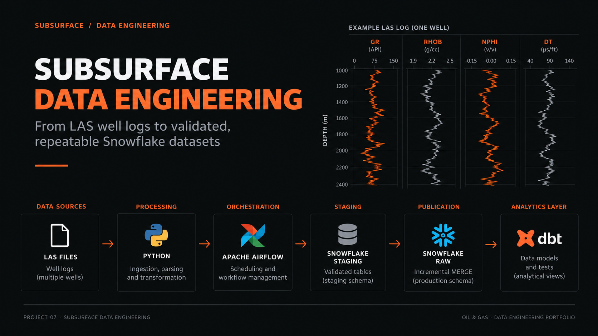
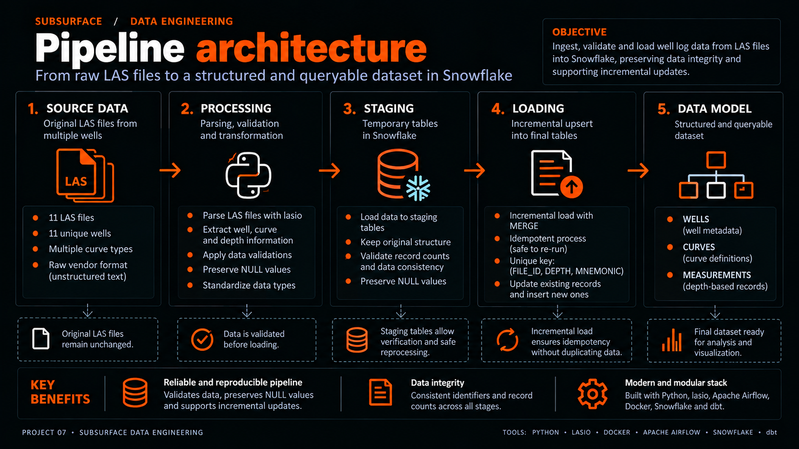
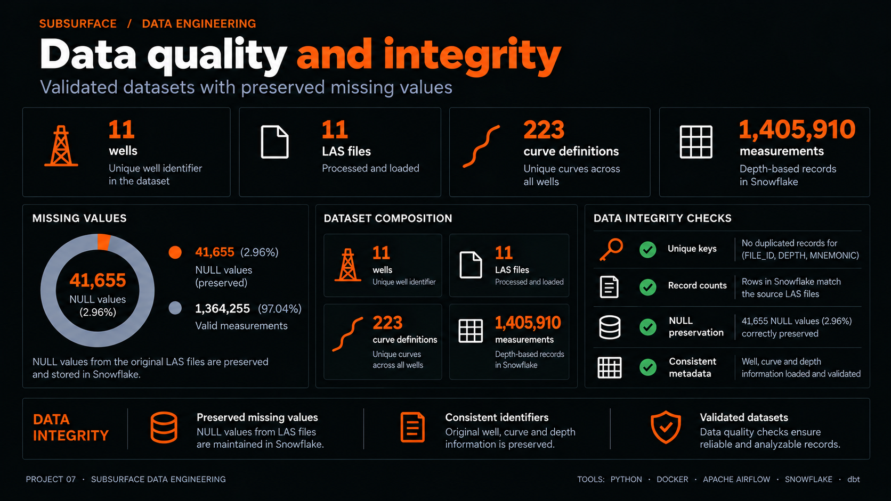
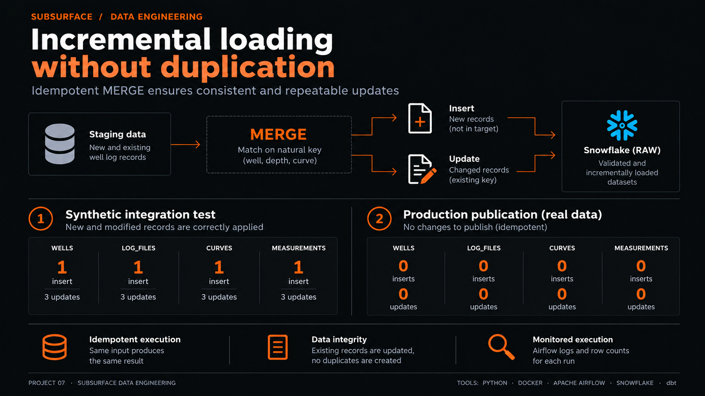

# 🛢️ Subsurface Data Engineering

## Project 07 – Data Analytics & Scientific Computing Portfolio

### From LAS well logs to validated, repeatable Snowflake datasets


---



*Conceptual project cover; the log curves are illustrative. The implementation and execution boundaries are detailed below.*

---

## 📌 Project Overview

Subsurface analysis depends on reliable data beneath every interpretation. This project turns geophysical Log ASCII Standard (LAS) files and well catalog metadata into a relational dataset that preserves file provenance, curve definitions, depth measurements, and missing values.

The implemented workflow processes **11 wells, 11 LAS files, 223 curve definitions, and 1,405,910 measurements**. Python prepares the datasets, Airflow orchestrates execution in Docker, and Snowflake supports validated staging and explicit incremental publication. A separate dbt layer exposes analytical views, including Gamma Ray summaries.

The engineering focus is repeatability: validate before publishing, distinguish meaningful changes from formatting differences, and commit related table changes together. The project provides a foundation for energy analytics and subsequent scientific workflows; it does not claim reservoir predictions or production-performance improvements.

---

## 🎯 Engineering Problem

LAS files contain curves with different descriptions, units, and sampling depths. Catalog metadata and measurements must remain connected without flattening away provenance or treating missing readings as zero.

Three practical challenges shape the implementation:

- **Consistent grain:** distinguish wells, files, curve positions, and individual measurements.
- **Data fidelity:** preserve missing readings and original curve units while flagging suspect metadata.
- **Safe repetition:** prevent duplicate loads and unnecessary updates when the same files are processed again.

---

## 🏗️ Solution Architecture

**Airflow orchestrates preparation, staging, and validation. RAW publication requires an explicit command.** The dbt models are maintained separately and are not tasks in the current DAG.



*The diagram summarizes the main flow. The full data model also includes LOG_FILES; `(FILE_ID, DEPTH, MNEMONIC)` is the MEASUREMENTS key, not a shared key for all tables. LAS is structured text. Parsing and CSV preparation do not implement comprehensive type standardization or unit harmonization. Airflow runs staging and preview; RAW publication and dbt remain separate explicit steps.*

| Technology | Implemented responsibility |
| --- | --- |
| Python, pandas, lasio | Parse LAS files, join catalog metadata, reshape readings, export CSVs |
| Apache Airflow 2.11.0 | Manually triggered task dependencies and execution logs |
| Docker Compose | Local Airflow standalone service and project mount |
| Snowflake Python Connector | Stage uploads, COPY, SQL validation, transaction control |
| Snowflake | Temporary staging, RAW storage, incremental MERGE |
| dbt | Four staging views, two analytical views, SQL data tests |
| unittest and SQLite | Offline regression tests and a simulated Snowflake execution adapter |

---

## 🗂️ Data Sources and Data Model

The local source collection (excluded from Git by `.gitignore`) consists of the **Kansas Geological Survey (KGS)** catalog archive, `data/catalog/ks_las_files.zip`, and 11 LAS files under `data/raw/`. The downloader retains catalog URLs and maps the legacy KGS file prefix to the Azure-hosted download prefix implemented in the source code. See [the downloader](ingestion/download_las.py) and [file metadata transformation](ingestion/build_log_files.py).

The current sample is a local collection, not a representative sample of Kansas reservoirs. The downloader selects the first 10 eligible distinct wells; replaying it alone does not reconstruct the existing 11-file collection.

| Dataset | Rows | Grain / business key | Purpose |
| --- | ---: | --- | --- |
| WELLS | 11 | `KGS_ID` | Well identity, operator, location, elevation |
| LOG_FILES | 11 | `FILE_ID` | File provenance, well reference, depth range, size |
| CURVES | 223 | `FILE_ID + CURVE_POSITION` | Curve mnemonic, original unit, description, quality flag |
| MEASUREMENTS | 1,405,910 | `FILE_ID + DEPTH + MNEMONIC` | One curve reading at one depth |

`WELLS → LOG_FILES → CURVES` preserves the metadata hierarchy. Measurements reference a file and match curve metadata through `(FILE_ID, MNEMONIC)`. The depth index becomes `DEPTH`; it is not an additional measurement curve in the long-format output.

---

## 🔄 ETL Pipeline

The [Airflow DAG](airflow/dags/subsurface_pipeline.py) defines:

```text
extract → transform → load → validate
```

1. **Extract:** acknowledge existing local LAS files. Downloading is a separate preparation step, not an automated DAG extraction task.
2. **Transform:** run the four `build_*.py` scripts. Well metadata is matched to local files, descriptive well text is cleaned, curves receive metadata quality flags, and measurements are reshaped from wide to long format. Output is written one LAS file at a time.
3. **Load:** upload CSVs with `PUT`, prepare temporary `STG_*` tables, load with `COPY INTO ... ON_ERROR = ABORT_STATEMENT`, validate, and preview changes. All temporary tables share the loader connection.
4. **Validate:** report completion of the checks already performed inside the loader. This task does not independently query Snowflake.

The DAG uses `schedule=None`, `catchup=False`, and a local SequentialExecutor. Its loader invocation supplies no publication flag, so automated runs remain in dry-run mode.

---

## ✅ Data Quality and Validation

Validation covers CSV-to-staging row counts, measurement NULL counts, and non-null, unique business keys in staging and RAW before publication. A separate local relationship check verifies that files have wells, curves have files, and measurements have curve metadata.

**41,655 missing measurement values are preserved.** They are represented as empty CSV values and checked against Snowflake NULL counts; they are not imputed or converted to zero.

Curve metadata is retained with three flags: `OK`, `UNIT_MISSING`, and `UNIT_SUSPECT`. The suspect-unit rule specifically identifies `DCAL` labeled `GAPI`; it is a targeted diagnostic, not comprehensive physical validation or unit harmonization.

The dbt layer adds relationship, not-null, uniqueness, accepted-value, measurement-to-curve, and Gamma Ray count checks. `fct_well_curves` joins well/file/curve metadata; `fct_gamma_ray_summary` reports total and non-null readings plus minimum, maximum, and mean GR in the recorded unit.



**Figure scope:** the dataset totals, 41,655 NULLs (2.96%), and 1,364,255 non-null readings (97.04%) agree with the local CSVs. “Valid measurements” in this image means non-null, not scientifically validated.

*Validation scope: record counts are compared between processed CSVs derived from LAS and Snowflake staging. Curve definitions are counted at `(FILE_ID, CURVE_POSITION)` grain, not as distinct mnemonic types. Metadata checks cover keys, relationships, counts, and targeted unit flags; they do not establish scientific validity or harmonize units.*

---

## 🔁 Incremental Loading and Idempotency

The [publisher](ingestion/load_snowflake.py) matches business keys, inserts missing rows, and updates existing rows only when non-key values differ through NULL-safe `IS DISTINCT FROM` comparisons.

For `WELLS.LOCATION`, whitespace is collapsed and trimmed **only in the MERGE comparison**. Whitespace-only differences do not trigger updates. Written values come directly from staging; the MERGE does not store a normalized replacement. Upstream well text cleaning remains a separate transformation.

All four MERGEs execute within one explicit transaction. Staging DDL occurs beforehand; errors during publication trigger a rollback attempt. Actual insert/update counts are reported after commit. Rows absent from the source are not deleted.

This is **incremental target publication over a full staging reload**, not change data capture. Concurrent writers must be serialized: preflight key checks are not uniqueness locks. A lost commit response can leave an uncertain server outcome requiring reconciliation.



*The key shown is schematic: MEASUREMENTS matches `(FILE_ID, DEPTH, MNEMONIC)`; the other datasets use the business keys listed above. The 1-insert/3-update synthetic results apply to isolated TESTING tables; RAW's 0/0 results are separate. Both remote results were supplied by the project author, as detailed in the evidence table. Airflow logs cover staging and preview; real publication and remote integration run through explicit commands. Duplicate prevention assumes validated keys and serialized writers.*

---

## 🧪 Testing, Reliability, and Evidence

| Result | Evidence available for this README |
| --- | --- |
| Four dataset counts; 41,655 missing values | Recounted from local CSVs; existing Airflow load logs also record matching Snowflake/staging counts |
| No empty or duplicate business keys in the four CSVs; no orphan relationships | Local key checks and relationship script |
| Successful four-task Airflow run | Persisted task logs for the October 26, 2026 manual run |
| 13 offline automated tests | Re-executed locally during README preparation |
| Six dbt models and 24 data tests successful | Historical local `subsurface_analytics/target/run_results.json` artifact dated October 22, 2026; excluded from Git and not rerun for this review |
| Isolated Snowflake integration PASS: 1 insert and 3 updates per table; second execution 0/0; rollback verified | Real execution output supplied by the project author in conversation; no corresponding remote-run log file located in the repository |
| Subsequent RAW publication: all four tables committed with 0 inserts and 0 updates | Real execution output supplied by the project author in conversation; no corresponding publication log file located in the repository |

Offline tests cover idempotency, inserts, updates, NULL transitions, LOCATION whitespace, invalid keys, transaction ordering, and injected BEGIN/MERGE/commit/rollback failures. SQLite executes comparisons while an adapter simulates MERGE; these tests do not establish Snowflake server behavior on their own.

The [isolated integration harness](tests/snowflake_merge_integration.py) calls the same publisher with eight unique temporary tables in `SUBSURFACE_DB.TESTING`. It logs planned names, checks visible objects for collisions, marks table ownership, and verifies ownership before cleanup. Pending cleanup is reported; connection loss may defer temporary-table removal until the server session ends. It does not read or write RAW or the original CSVs.

---

## 🚀 How to Run

Run commands from the repository root. Docker Desktop with Compose and a Snowflake account are required for the container workflow. Offline tests need a Python environment with pandas; transformations additionally require lasio.

### 1. Prepare the environment

Supply `SNOWFLAKE_ACCOUNT`, `SNOWFLAKE_USER`, `SNOWFLAKE_PASSWORD`, `SNOWFLAKE_WAREHOUSE`, `SNOWFLAKE_DATABASE`, `SNOWFLAKE_SCHEMA`, and `SNOWFLAKE_ROLE` through your private environment. Use `SUBSURFACE_DB` and `RAW` for the normal loader context. Never commit environment files or credentials.

The loader assumes the four RAW tables, `SUBSURFACE_DB.RAW.LAS_STAGE`, and `SUBSURFACE_DB.RAW.LAS_CSV_FORMAT` already exist. Their provisioning DDL is not included. The CSV format must preserve empty measurement fields as SQL NULLs. Provide the catalog archive and the intended LAS collection before transforming.

The Dockerfile pins Airflow and lasio but does not explicitly install every runtime dependency or provide a complete dependency lock. Confirm pandas and `snowflake.connector` are importable in a fresh image; the previously working container is not proof of a fully reproducible clean build.

```powershell
docker compose -f airflow/docker-compose.yml up -d --build
```

Open Airflow at `http://localhost:8081` and manually trigger `subsurface_pipeline` to rebuild CSVs and run staging validation. For existing processed CSVs, run the loader directly:

```powershell
docker exec subsurface-airflow python -u /opt/subsurface_project/ingestion/load_snowflake.py --dry-run
```

Dry run leaves RAW unchanged, but uploads to the internal stage and creates/loads temporary staging tables; it is not a remote read-only operation.

### 2. Run offline checks

Using the existing Windows virtual environment:

```powershell
.venv/Scripts/python.exe -m unittest discover -s tests -p "test_*.py" -v
.venv/Scripts/python.exe tests/test_relationships.py
```

The relationship script needs the processed CSVs. Remote integration is deliberately excluded from automatic test discovery.

### 3. Run controlled integration or publication

The following commands perform remote writes. Use them deliberately with appropriate privileges and an approved environment.

```powershell
# Synthetic objects in TESTING; no RAW writes
docker exec subsurface-airflow python -u /opt/subsurface_project/tests/snowflake_merge_integration.py --run-snowflake

# Explicit publication to RAW; not called automatically by Airflow
docker exec subsurface-airflow python -u /opt/subsurface_project/ingestion/load_snowflake.py --publish
```

Integration requires metadata visibility in TESTING and permission to create that schema if absent. The schema remains after temporary-table cleanup. See [integration instructions](tests/SNOWFLAKE_INTEGRATION.md) and [publication notes](ingestion/INCREMENTAL_PUBLICATION.md).

The dbt project uses the externally configured `subsurface_analytics` profile. Run `dbt build` from `subsurface_analytics/` only after configuring a private Snowflake profile and the intended output schema. It is separate from Docker/Airflow orchestration.

---

## 📁 Repository Structure

```text
Project_07_Subsurface_Data_Engineering/
├── airflow/
│   ├── dags/subsurface_pipeline.py
│   ├── Dockerfile
│   └── docker-compose.yml
├── assets/                  # four portfolio images
├── data/                    # local datasets; excluded from Git
│   ├── catalog/
│   ├── raw/
│   └── processed/
├── ingestion/               # Python preparation and Snowflake publication
├── subsurface_analytics/    # dbt project
│   ├── models/
│   │   ├── staging/
│   │   └── marts/
│   ├── tests/
│   └── dbt_project.yml
├── tests/                   # offline tests and isolated integration harness
├── README.md
└── .gitignore
```

Local datasets, logs, credentials, environments, and generated dbt artifacts are excluded by `.gitignore`; sanitized execution evidence remains a separate publication task.

Four images are embedded using repository-relative paths: `project_cover.png`, `pipeline_architecture.png`, `data_quality.png`, and `incremental_loading.png`. Figure notes distinguish verified results from illustrative or unsupported claims. All use charcoal backgrounds, orange accents, warm white headings, and technical gray annotations.

---

## 📊 Key Engineering Outcomes

- Converted heterogeneous LAS and catalog data into explicit, traceable relational grains covering **1.4 million measurements**.
- Preserved **41,655 missing readings** while separating metadata flags from scientific interpretation.
- Made repeated publication conditional on real changes, with transaction control across four related tables.
- Kept normal Airflow execution in preview mode and exercised publication behavior through a separate synthetic integration path.
- Added an analytical SQL layer without embedding analytics execution into the ingestion DAG.

---

## ⚠️ Limitations and Future Improvements

The current implementation is a local portfolio deployment with a small, non-random well sample. It does not establish production availability, throughput, operating cost, or reservoir-model accuracy.

Priorities for further work are a versioned source manifest and redistribution/license review; reproducible dependency and Snowflake-object provisioning; sanitized, persisted remote execution evidence; CI for offline tests; production-grade scheduling and observability; and schema/type/unit validation beyond the current targeted checks. Repeated curve mnemonics and overlapping file versions need explicit handling before broadening the source collection.

The current transforms regenerate the complete CSV collection, and processing holds one LAS file and its long-format expansion in memory. Larger deployments need measured scaling work. The dbt profile, credentials, and target schema remain environment-specific; historical build artifacts do not guarantee a fresh deployment will reproduce the same results.

---

## 👤 About Me

**Martin Panelo**

Data Analyst | Data Engineer | Geophysicist

[LinkedIn](https://www.linkedin.com/in/martinpanelo/)
